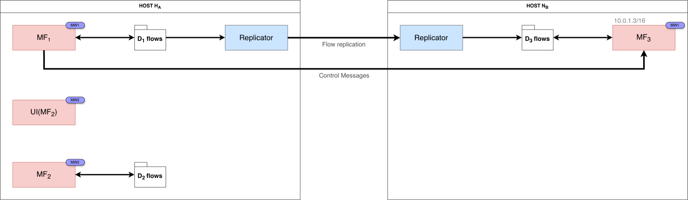

# DMF Security: Assets & Requirements

_(c) AMWA 2026, CC Attribution-NoDerivatives 4.0 International (CC BY-ND 4.0)_

This document identifies the parts of the Dynamic Media Facility (DMF) that are relevant from a security perspective, the assets to protect, and the security requirements for those assets. It considers confidentiality (C), integrity (I), and availability (A), together with authenticity and non-repudiation (A/NR), which are especially relevant for media. See [The CIA triad and supporting security properties](#the-cia-triad-and-supporting-security-properties) for definitions.

## System under consideration

The system under consideration comprises assets drawn from the EBU Dynamic Media Facility (DMF) Reference Architecture v2.0. A production (called a **Media Workload** in the reference architecture) runs across one or more Hosts: the machines in a Cluster that run the Container Platform. Each **Host** executes one or more **Media Functions**, stateless containerised units that process media, such as mixing, graphics, or format conversion.

Media Functions are granted access to **Domains**, which define which Flows they may access. Within a Domain, **Flows** carry timestamped media payloads (Grains) between authorised Media Functions. **Replicators** propagate Flows between Nodes in a Cluster.

*Figure 1 — System under consideration.*

The reference architecture describes a zero-trust model based on authentication, authorisation and accounting, least-privilege access, segmentation, and continuous monitoring. It leaves two security points open: whether media payloads must be encrypted, and how security should be handled across multiple Clusters.

## Assets

The first table lists assets in the reference architecture. The second lists additional assets assumed to be part of a future DMF.

| Asset | Description | C | I | A | A/NR |
| --- | --- | :---: | :---: | :---: | :---: |
| **Host** | Runs an operating system and is grouped into a Cluster. Kubernetes uses the term “Node” for a Host. A Host executes Media Functions. | ✓ | ✓ | ✓ | ✓ |
| **Media Workload** | An organised collection of Media Functions and the Flows that connect them, working together to transform inputs into a Media Product. | ✓ | ✓ | ✓ | ✓ |
| **Media Function** | A stateless processing unit that performs an operation on media, such as format conversion, mixing, colour correction, or graphics rendering. It is provisioned as one or more Containers. | ✓ | ✓ | ✓ | ✓ |
| **Domain** | A Media Exchange layer mechanism that identifies which Flows Media Functions may access. In the MXL SDK, a Flow is addressed by the tuple {Host ID, Domain ID, Flow ID}, which uniquely identifies a directory of memory-mapped files holding Grains. | (✓) | ✓ | ✓ | ✓ |
| **Flows** | Audio, video, ancillary data, and associated metadata transported by MXL. | (✓) | ✓ | ✓ | ✓ |
| **Replicator** | A service that replicates media Flows between Nodes so authorised Media Functions on different Hosts can consume the same media. |  | ✓ | ✓ | ✓ |

*Table 1 — Assets in the reference architecture.*

### Assumed future assets

| Asset | Description | C | I | A | A/NR |
| --- | --- | :---: | :---: | :---: | :---: |
| Flow Orchestration | Management of Media Functions and Flows, including device and application configuration. | ✓ | ✓ | ✓ | ✓ |
| Production | A group of Media Workloads servicing one media production. | ✓ | ✓ | **✓** |  |
| Control plane | Ability to control Media Functions and Flows, including orchestration. | ✓ | ✓ | ✓ | ✓ |
| Exposed media services | Services with ports exposed outside the DMF, such as media streams. |  | ✓ | ✓ | ✓ |
| Operational interfaces | Services communicating with external user interfaces and APIs. |  | ✓ | ✓ | ✓ |
| Identity | Identity and associated privileges of a human operator interacting with the system. | ✓ | ✓ | ✓ | ✓ |
| Logs | Security and operational records; source material for SIEM and other cyber-automation tools. | ✓ | ✓ | ✓ | ✓ |

*Table 2 — Assumed future assets.*

## Security requirements

- Each entity in a DMF shall have a **verifiable identity**.
- Identities and credentials shall be centrally managed in a DMF.
- Authentication and authorisation shall be centrally managed in a DMF.
- Flows, Domains, control, state, logs, and monitoring information shall be protected against **unauthorised** access, modification, and deletion.
- Control actions shall be **authenticated**, **authorised**, **attributable**, and protected against replay.
- Each Media Function shall check the **identity and authorisation** of the source of requested actions.
- Configuration changes shall be validated, **auditable**, and **reversible**.
- Credentials, connections, permissions, and retained data shall be **withdrawn or disposed of** when no longer required.
- All hardware and software hosting or supporting the DMF shall be secured and **hardened** according to relevant best practices.
- High-impact operator actions shall include **safeguards against human error**.
- Availability, capacity, latency, timing, and recovery requirements shall be clearly defined, and limits shall be enforced.
- Hosts and Media Functions shall be protected against denial-of-service attacks, including resource exhaustion.
- Failures, degradation of functionality, and security-relevant changes in a DMF shall be detectable so that an automated or operator response can be triggered.
- Required security and operational events shall be **logged**, identifying their source and relevant subject using verifiable identities. Logs shall contain sufficient context and accurate timestamps to support correlation and investigation, but no sensitive information.
- Log collection, transport, storage, and retrieval shall meet defined availability and retention needs.
- Changes to logging and retention arrangements shall be authorised, validated, and auditable.
- Media Workload resources and relationships shall be **isolated** from other, unrelated Media Workloads and productions according to risk.
- Critical functions and Flows shall have defined **continuity** and recovery arrangements.

## The CIA triad and supporting security properties

| Abbreviation | Property | Description |
| --- | --- | --- |
| **C** | **Confidentiality** | Preserving authorised restrictions on information access and disclosure, including protecting personal privacy and proprietary information. |
| **I** | **Integrity** | Guarding against improper information modification or destruction, including ensuring authenticity and non-repudiation. |
| **A** | **Availability** | Ensuring *timely*[^1] and reliable access to and use of information. |
| **A/NR** | **Authenticity** | The assurance that an entity, user, system, or data is genuine and has not been impersonated or falsified. |
|  | **Non-repudiation** | The assurance that the origin and integrity of data or an action can be proven, preventing an individual or entity from falsely denying having performed that action. |

*Table 3 — The CIA triad and supporting security properties.*

## References

- The Dynamic Media Facility: Reference Architecture v2.0.
- [MXL releases](https://github.com/dmf-mxl/mxl/releases/).

[^1]: Real-time media production has stringent timing requirements; availability comes first.
